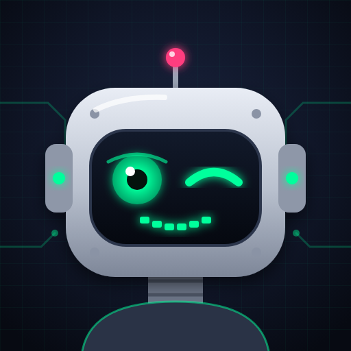
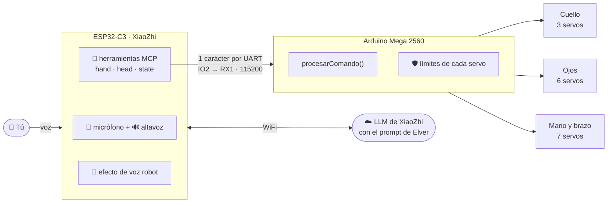
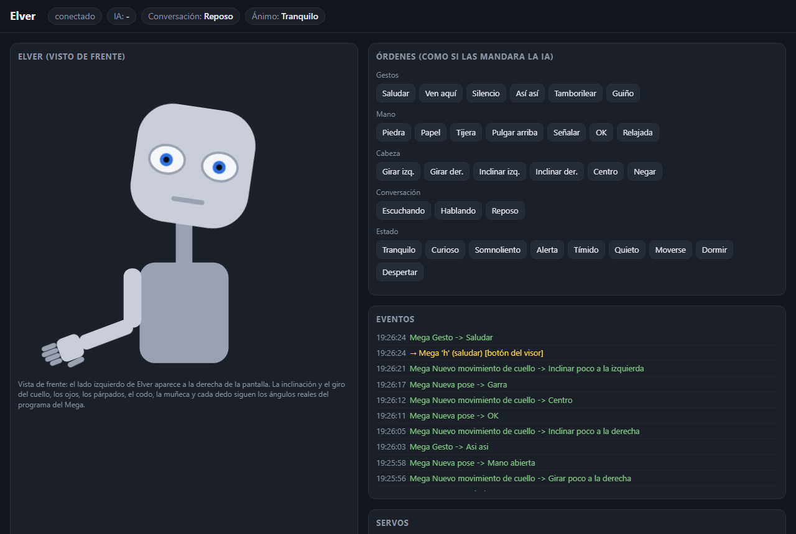

<div align="center">



# ELVER

### El humanoide impreso en 3D que te escucha, te mira y te contesta

**16 servos · Arduino Mega · ESP32-C3 con IA de voz · 100 % en español**

[](arduino/humanoide-automatico)
[](esp32-xiaozhi)
[](arduino)
[](simulador)
[](#-el-equipo)

[](https://github.com/Joseba-Rodriguez/3D-Humanoid/stargazers)
[](https://github.com/Joseba-Rodriguez/3D-Humanoid/commits/main)
[](#)

[Qué hace](#-qué-hace) · [Arquitectura](#️-arquitectura) · [Empezar](#-empezar-en-5-minutos) · [Simulador](#-pruébalo-sin-robot-simulador) · [Comandos](#️-comandos) · [Conexionado](#-conexionado)

</div>

---

> **"Elver, juguemos a piedra, papel o tijera."**
> Elver cuenta *"una, dos y tres"*, saca la mano en tijera y te pregunta qué has sacado tú.
> Sin trampas: elige su jugada antes de saber la tuya.

---

## ✨ Qué hace

<table>
<tr>
<td width="50%" valign="top">

### 👀 Ojos que parecen vivos
6 servos para párpados y mirada. Parpadea con ritmo natural, fija la vista, mira de reojo y guiña un ojo cuando hay complicidad. Los tiempos siguen una campana de Gauss, así que no se ve "robótico".

### 🧠 Cinco estados de ánimo
**Tranquilo · Curioso · Somnoliento · Alerta · Tímido**. Cada uno cambia cómo parpadea, cuánto mantiene la mirada, la velocidad de la mano y la frecuencia de los gestos. La IA cambia el ánimo según la emoción de cada respuesta.

### 🗣️ Conversación con cuerpo
Mientras **escucha**, atiende: cabeza quieta y ojos al frente. Mientras **habla**, mueve la cabeza, aparta la mirada de vez en cuando y gesticula con la muñeca, como una persona.

</td>
<td width="50%" valign="top">

### ✋ Mano expresiva
7 servos entre dedos, pulgar con oposición, muñeca y codo. Piedra, papel, tijera, 👍, 👌, señalar, saludar, "ven aquí", "silencio", "así así" y tamborilear con los dedos.

### 🤖 Voz de robot de verdad
Efecto de voz robótica hecho a mano en el ESP32-C3: filtro de peine y modulación en anillo, todo en enteros porque el chip no tiene coma flotante.
🔊 [Escucha la voz original](esp32-xiaozhi/muestras-voz/0-original.wav) y luego [la de Elver](esp32-xiaozhi/muestras-voz/elver-fuerte-A.wav).

### 🛡️ Límites a prueba de bombas
Ningún servo puede pasarse de su rango, venga la orden de donde venga. Un auditor bombardea el programa con comandos al azar y revisa **cada** escritura en los servos.

</td>
</tr>
</table>

---

## 🏗️ Arquitectura



El reparto de trabajo es sencillo: **el Mega da vida y el ESP32 da significado**.
El Mega parpadea, mira y se mueve solo, y nunca deja que un servo se pase de su límite. La IA solo elige *qué* gesto hacer, y el ESP32 se lo manda al Mega con una única letra.

---

## 🚀 Empezar en 5 minutos

**Solo el robot (sin IA):**

1. Abre [`arduino/humanoide-automatico/humanoide-automatico.ino`](arduino/humanoide-automatico/humanoide-automatico.ino) con el **Arduino IDE**.
2. Placa: **Arduino Mega 2560**. Solo usa la librería `Servo.h`, que viene con el IDE.
3. Súbelo, abre el **Monitor Serie a 9600 baudios** y escribe `?` para ver la ayuda.

Elver arranca en modo automático: parpadea, mira a su alrededor y hace poses con la mano él solo.

**Con voz:** sigue la guía de [`esp32-xiaozhi/`](esp32-xiaozhi) y conecta **IO2 del ESP32 → pin 19 (RX1) del Mega**, más **GND con GND**.

---

## 🎮 Pruébalo sin robot: simulador

¿No tienes el robot a mano? El simulador **compila el sketch real** (sin tocar ni una línea) y lo ejecuta en tu PC con un visor web:

<div align="center">

</div>

```bash
cd simulador/mega-pc
pip install ziglang pyserial
python compilar.py                   # compila el .ino para el PC
python puente.py --teclado --visual  # Elver en el navegador, con botones
python puente.py --prueba            # prueba automática: 36 comprobaciones
python puente.py --limites 120       # 2 minutos de comandos al azar auditando límites
```

Con la placa XiaoZhi conectada por USB, `python puente.py --visual` reenvía al Mega simulado las órdenes que da la IA mientras hablas con ella.
Hay también un [simulador clásico en Tkinter](simulador/simulador_humanoide.py), con un deslizador por servo.
Todos los detalles están en [`simulador/`](simulador).

---

## ⌨️ Comandos

Un carácter por el Monitor Serie (9600) o desde el ESP32 por Serial1 (115200):

| Grupo | Comandos |
|---|---|
| 😌 **Ánimo** | `0` tranquilo · `1` curioso · `2` somnoliento · `3` alerta · `4` tímido |
| 👋 **Gestos** | `h` saludar · `v` ven aquí · `s` silencio · `m` así así · `t` tamborilear · `g` gesto al azar |
| ✊ **Mano** | `n` piedra · `b` papel · `x` tijera · `u` 👍 · `w` señalar · `o` 👌 · `r` relajada |
| 🙂 **Cabeza** | `C` centro · `I`/`D` inclinar izq./der. · `L`/`R` girar izq./der. · `N` negar |
| 😉 **Otros** | `j` guiño · `q` quieto (posar para fotos) · `Q` fin de quieto · `d` dormir · `a` despertar |
| 💬 **Conversación** | `E` escuchando · `H` hablando · `Z` reposo *(los envía el ESP32)* |

---

## 🔌 Conexionado

<details>
<summary><b>Ver la tabla de los 16 servos</b></summary>

| Módulo | Motor | Pin | Función |
|---|---|---|---|
| Cuello | 7 | 36 | Inclinación hacia la izquierda |
| Cuello | 8 | 37 | Inclinación hacia la derecha |
| Cuello | 9 | 38 | Giro izquierda/derecha |
| Ojos | 10 | 39 | Párpado superior izquierdo |
| Ojos | 11 | 40 | Párpado superior derecho |
| Ojos | 12 | 41 | Párpado inferior izquierdo |
| Ojos | 13 | 42 | Párpado inferior derecho |
| Ojos | 14 | 43 | Mirada vertical (ambos ojos) |
| Ojos | 15 | 44 | Mirada horizontal (ambos ojos) |
| Mano | 1 | 30 | Pulgar, flexión |
| Mano | 2 | 31 | Índice |
| Mano | 3 | 32 | Corazón |
| Mano | 4 | 33 | Anular + meñique |
| Mano | 5 | 34 | Pulgar, oposición (recorrido muy reducido) |
| Mano | 6 | 35 | Muñeca, giro |
| Brazo | 16 | 45 | Codo, arriba/abajo |
| **ESP32** | IO2 | **19 (RX1)** | Órdenes de la IA (115200, solo ESP32 → Mega) |

> ⚠️ Con 16 servos, aliméntalos desde **una fuente aparte** con la GND común al Mega, no desde el pin de 5 V del Arduino.

</details>

---

## 📁 Estructura

```
3D-Humanoid/
├── arduino/
│   ├── humanoide-automatico/   ⭐ el programa completo de Elver (cárgalo en el Mega)
│   └── modulos/                pruebas por partes: cuello, ojos, mano, calibración, mano con guante flex
├── esp32-xiaozhi/              herramientas MCP, voz robótica y prompt de la IA
├── simulador/
│   ├── mega-pc/                el sketch real compilado para el PC + visor web + auditor
│   └── simulador_humanoide.py  simulador Tkinter con deslizadores
└── docs/img/
```

---

## 🗺️ Hoja de ruta

- [x] Ojos, cuello y mano con movimiento natural
- [x] Cinco estados de ánimo
- [x] Control por voz con IA (XiaoZhi + MCP)
- [x] Voz robótica en el propio ESP32
- [x] Simulador con el sketch real y auditoría de límites
- [ ] Vídeo de Elver en acción
- [ ] Publicar los modelos 3D para imprimir

---

## 👥 El equipo

Elver es un proyecto a cuatro manos:

- **José Manuel**: diseño físico, impresión 3D (Prusa) y todo el hardware.
- **Joseba** ([@Joseba-Rodriguez](https://github.com/Joseba-Rodriguez)): software, IA conversacional y simulador.

¿Ideas, mejoras o tu propio Elver? Lee [CONTRIBUTING.md](CONTRIBUTING.md) y abre un *issue*.

---

<div align="center">

### ⭐ Si Elver te ha sacado una sonrisa, dale una estrella: le ayuda a crecer (y él te guiñará un ojo 😉)

[](https://star-history.com/#Joseba-Rodriguez/3D-Humanoid&Date)

<sub>Hecho en Bilbao con servos, PLA y muchas horas de calibración 🤖</sub>

</div>
